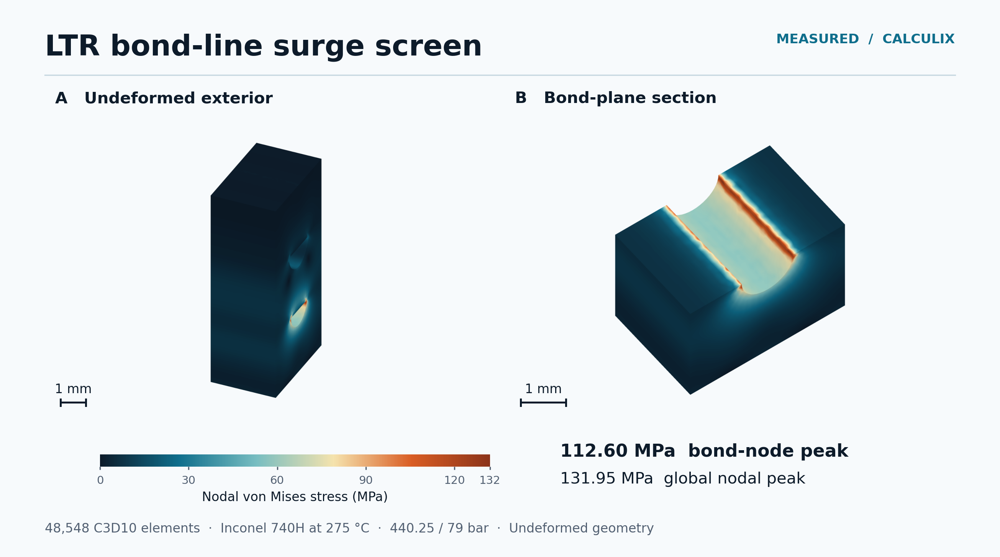
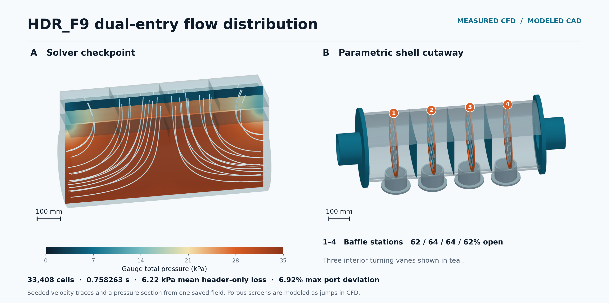
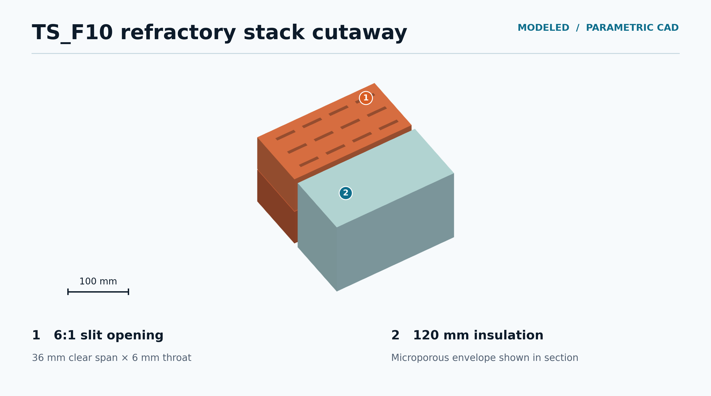
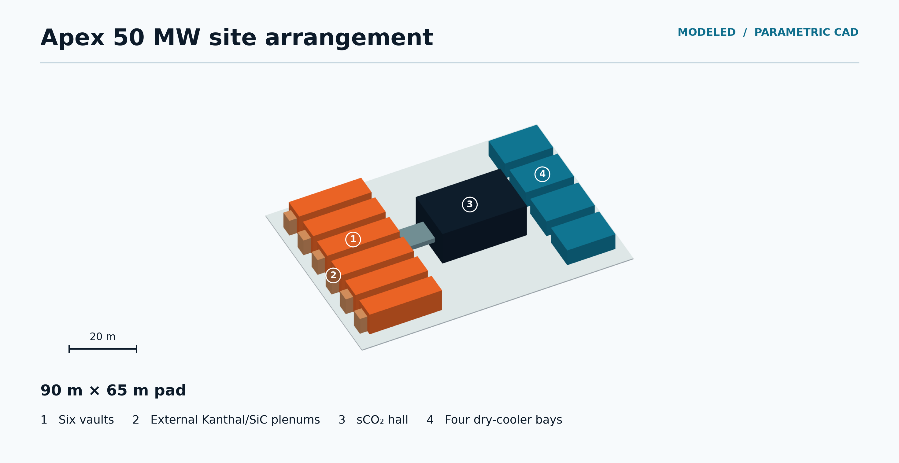

# Apex-Continuum-50 v2 — Open-Source 50 MW Thermal-to-sCO₂ Long-Duration Energy Storage

**Author:** Bruce McGinley  
**Release:** v2.0.0 — Continuum-Audited Dry Baseline (November 25, 2026)  
**Licenses:** Code & scripts (`MIT`) · 3D CAD & hardware (`CERN-OHL-P v2`) · Paper, deck & figures (`CC-BY-4.0`)

**Apex-Continuum-50 v2** is a open-source, continuum-audited computational baseline for a **50.00 MW net AC** dry-cooled Long-Duration Energy Storage (LDES, 24–100+ hr) plant. It couples a zero-salt magnesia-spinel refractory brick thermal battery (`TS_F10`) with a compact supercritical CO₂ (`sCO₂`) recompression closed Brayton cycle (`RCBC`) using etched Printed Circuit Heat Exchangers (`PCHEs`) and a commercial `3,600 RPM` geared synchronous generator.

This project is released publicly under permissive open licenses so utilities, EPC firms, universities, national laboratories, and energy engineers worldwide can inspect, test, and build on the design.

---

## Frozen Audited Dry Baseline (`APEX_V2_FINAL_AUDIT_REPORT.md`)

All quantitative plant claims below are **MODELED** from a 192-interval `CoolProp 7.2.0` (`HEOS::CO2`) closure incorporating **MEASURED** component physics from `CalculiX` 3D conformal FEA and `OpenFOAM v2312` 3D CFD. Uncertified campaign credits (`$6.58M` Duplex 2205 LTR substitution, `RIB_F8` pin-rib upside, and `Desert_Mist`) were explicitly stripped out (`$0` credit).

| System Parameter | 20 °C ISO Design | 42 °C Dry Summer | Evidence Basis |
| :--- | :---: | :---: | :--- |
| **Net AC / Gross AC Export** | **50.00 / 50.90 MW** | **45.08 / 46.01 MW** | `CoolProp 7.2.0` HEOS (`<0.03 Pa` pressure closure residual) |
| **Net Cycle Eff. / AC RTE** | **52.83% / 52.36%** | **48.93% / 48.49%** | Includes `0.991` `TS_F10` thermal factor |
| **LTR / HTR Pinch Margin** | **10.17 K / 18.66 K** | **11.88 K / 20.15 K** | Conservative Variant B `Nu = 43.66` (`0.5942×`) |
| **Hottest LTR Fluid Terminal** | `229.77 °C` | `262.76 °C` | Full Inconel 740H retained |
| **Installed Power Block CAPEX** | **`$65.50M` (`$1,309.99/kWe`)** | `$65.50M` (`$1,453.11/kWe`) | Full 740H, `$0` duplex credit |
| **24-Hr / 100-Hr LCOS (Elec.-Only)** | **`$82.48 / $98.50 / MWh`** | **`$89.86 / $107.05 / MWh`** | `$25/MWh` charge, `8.02%` CRF, `180 / 50` cyc/yr |

### Component Continuum Audit Verdicts (`MEASURED`)
- **Gate 1 — CalculiX C3D10 Surge FEA (`440.25/79 bar`, `48,548` elements):** Inconel 740H (`275 °C`) measured **`112.60 MPa`** peak bond-node von Mises (`131.95 MPa` global peak, `1.15%` finest-two mesh drift). Thickened SS316L failed its `115 MPa` screen (`117.53 MPa`). Duplex 2205 cleared `240 °C` (`112.60 MPa`) but was excluded because summer LTR hot inlet reaches `262.76 °C` without a certified dissimilar-bond zone.
- **Gate 2 — OpenFOAM `pimpleFoam` `HDR_F9` (`33,408` cells):** Original `34%/44%` baffle failed (`25.35 kPa`, `9.32%` dev). Rectified **`62%/64%`** taper measured **`6.22 kPa`** header-only time-window loss and **`6.92%`** max port deviation (beating `HDR_F8`'s `8.90%`, though still above the `2.5%` stretch goal).
- **Gate 3 — OpenFOAM `RIB_F8` (`105,000` cells):** Measured `Nu = 43.62` (below control `43.66`) and upper-window `f = 0.01325` (`+14.25%` vs. `0.01160`) → **excluded (`0` credit)**.

---

## Visual Overview

| Gate 1 · 740H FEA (`MEASURED`) | Gate 2 · Rectified `HDR_F9` (`MEASURED CFD / MODELED CAD`) |
| :---: | :---: |
|  |  |
| `TS_F10` Refractory Stack (`MODELED CAD`) | 50 MW Site Layout (`MODELED CAD`) |
|  |  |

---

## Repository Map

[Download the tagged release](https://github.com/bpmcginley/apex-continuum-50/releases/tag/v2.0.0). The lite release includes the figure fields and selected audit records. A full rerun would also require the original case builders and boundary-condition files.

- [`APEX_V2_FINAL_AUDIT_REPORT.md`](APEX_V2_FINAL_AUDIT_REPORT.md) — Authoritative zero-trust continuum audit & SHA-256 custody ledger.
- [`final_release/`](final_release/) — Open-Source Technical Brief (`.pptx` + `.pdf`), 7-page Scientific PoC Paper (`.pdf`), and four 300-DPI engineering figures.
- [`paper_source/`](paper_source/) — LaTeX source and vector figures for two-pass PDF compilation (`TEXINPUTS="../final_release:" pdflatex Apex_Continuum_50_v2_Scientific_PoC_Paper_FINAL.tex`).
- [`stl_models/`](stl_models/) — Four scale-accurate parametric 3D CAD `.stl` assemblies (`hdr_f9_rectified_62_64.stl`, `ltr_740h_unit_cell.stl`, `ts_f10_magnesia_spinel_brick.stl`, `apex_50mw_plant_pad.stl`).
- [`solver_evidence/`](solver_evidence/) — Raw CalculiX `bond.inp`/`bond.frd`, OpenFOAM `checkpoint_0.758263_internal.vtu` & `hydraulics.csv`, `gate1.json`, `gate3_cycle.json`, `preflight.json`.
- [`CONTRIBUTING.md`](CONTRIBUTING.md) — How labs, universities, and EPCs can tackle the 5 open physical hardware & qualification gates.
- [`PUBLISH_GUIDE_AND_POSTS.md`](PUBLISH_GUIDE_AND_POSTS.md) — Step-by-step GitHub, Zenodo DOI, preprint, and outreach guide.

## Open Hardware & Qualification Gates
This release is a **computational proof-of-concept**. Five hardware and qualification gates remain open for community, lab, and industry execution (see [`CONTRIBUTING.md`](CONTRIBUTING.md)):
1. **Inconel 740H diffusion-bond creep & fatigue coupons** (plus coupled thermal-gradient FEA).
2. **Module-level PCHE heat-transfer scaling** beyond the periodic unit-cell film basis (`Nu = 43.66`).
3. **Cold-flow `HDR_F9` header rig testing** to push port deviation from `6.92%` below `2.5%`.
4. **Binding OEM turbomachinery maps & vendor quotes** (geared `3,600 RPM` WRSM, etched `740H` PCHEs, header).
5. **Formal `US11530625B2` claim-chart review** of the external Kanthal/SiC forced-convection charging plenum.
